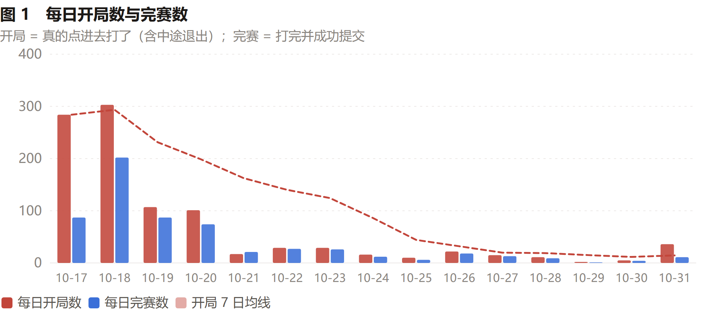
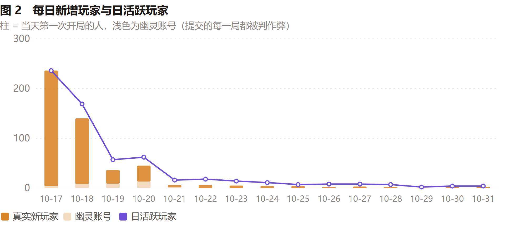
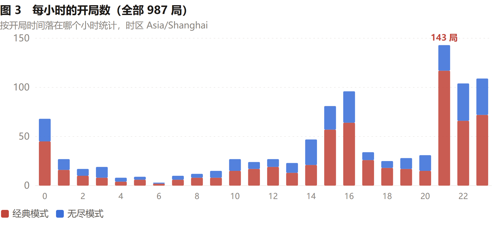
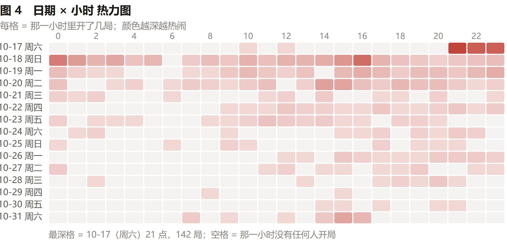
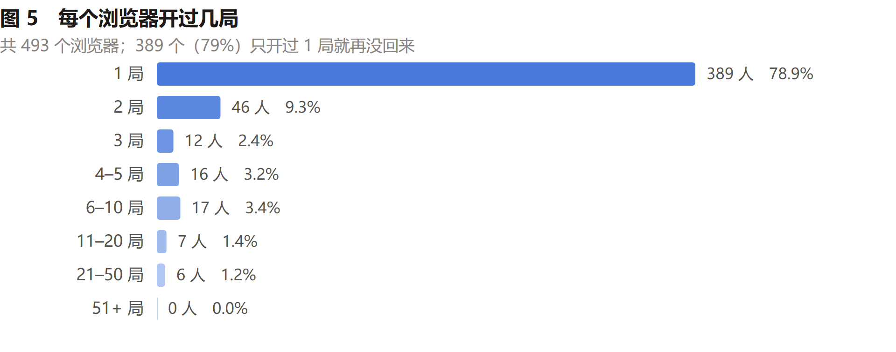
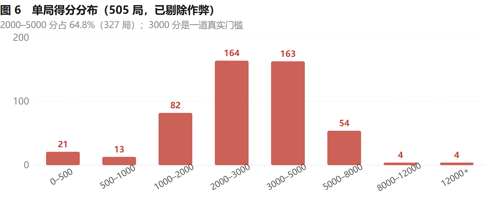
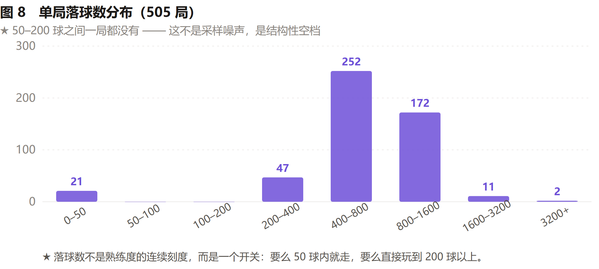
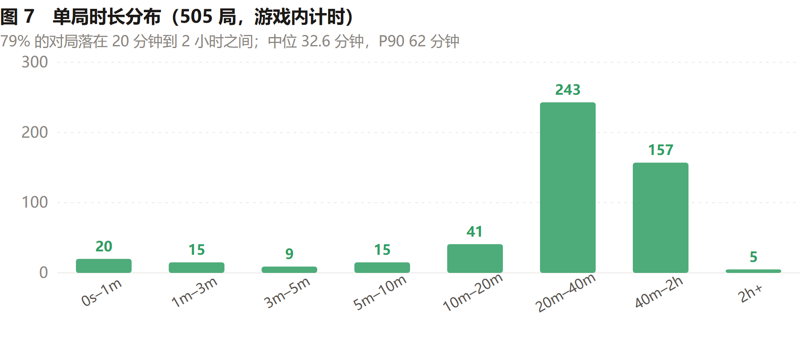

# 公开数据集

`public-dataset.json` / `public-dataset.csv`：比赛期间全部 **598 局**提交记录的匿名版。

## 这份数据长什么样

下面几张图全部由本目录的 `public-dataset.json` 直接画出来（脚本见 `../tools/export-analytics.mjs`）。

















## 已经做了什么

- 玩家身份换成 `p0001`、`p0002`……，按**首次提交时间**排序分配，与真实 ID 无任何对应关系
- **不含**昵称、clientId、IP、IP 哈希、操作序列（trace）
- 时间统一为 UTC ISO 8601

## 字段

| 字段 | 含义 |
|---|---|
| `player` | 匿名玩家编号 |
| `mode` | `classic`（活动经典） / `endless`（岗位无尽） |
| `score` | 本局分数 |
| `maxLevel` | 本局达到的最高球等级（1–11） |
| `merges` | 合成次数 |
| `loopCount` | 无尽模式循环次数 |
| `durationMs` | 游戏内计时（不含挂机） |
| `drops` | 本局投放球数 |
| `flagged` | 是否被反作弊判为可疑（true 的成绩不进榜） |
| `submittedAt` | 提交时间（UTC） |

`board` 段是按「每人每模式取最高分、同一人只留一个榜」算出来的最终排名，
可直接用来复现榜单。

## 用法示例

```bash
node -e "
const d=require('./public-dataset.json');
const clean=d.runs.filter(r=>!r.flagged);
console.log('有效局数', clean.length);
const byMode={};
for(const r of clean){(byMode[r.mode]??=[]).push(r.score);}
for(const [m,s] of Object.entries(byMode)){s.sort((a,b)=>a-b);
  console.log(m,'中位',s[Math.floor(s.length/2)],'P90',s[Math.floor(s.length*.9)]);}
"
```

## 出处与再生成

由 `tools/export-public-dataset.mjs` 从线上库只读导出。原始库里没有采集任何
浏览器指纹或个人信息，只有随机生成的 clientId；公开版又把 clientId 换成了编号。
