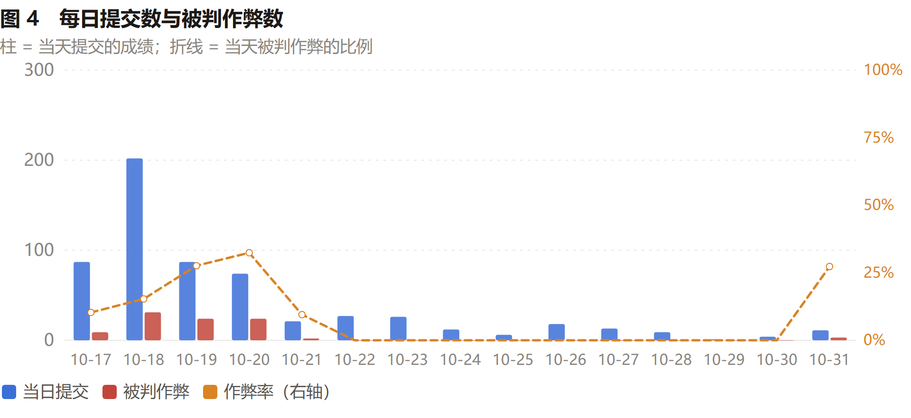
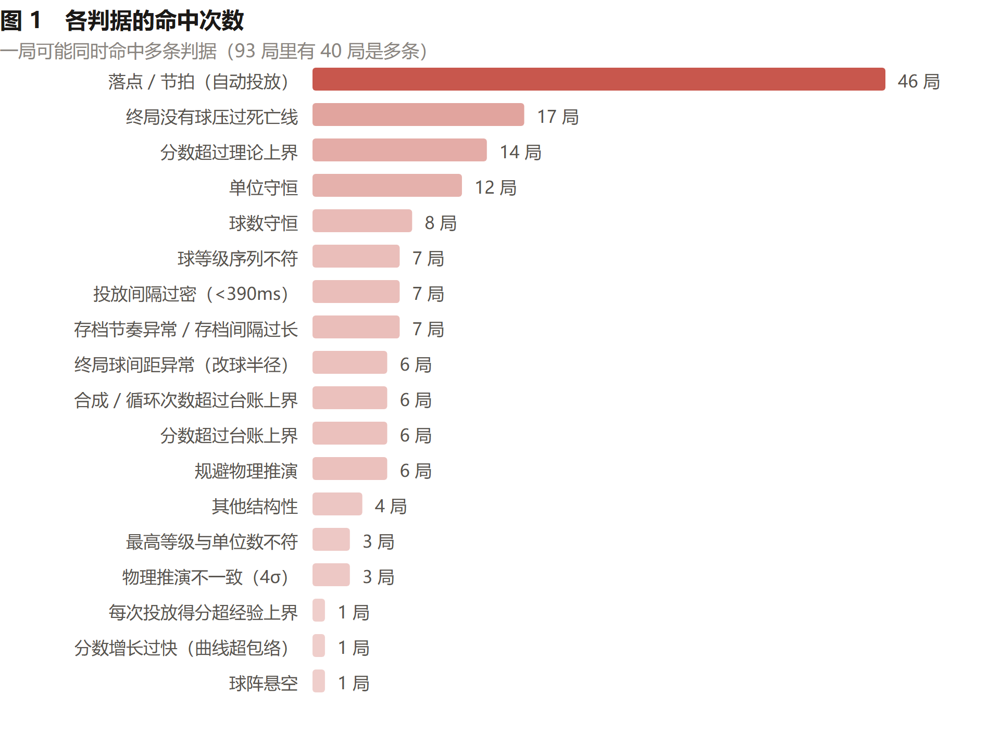
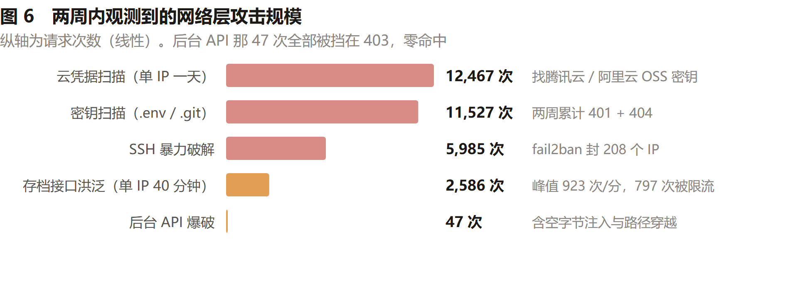
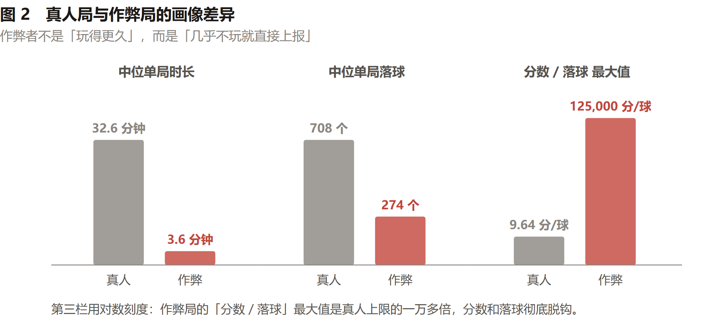
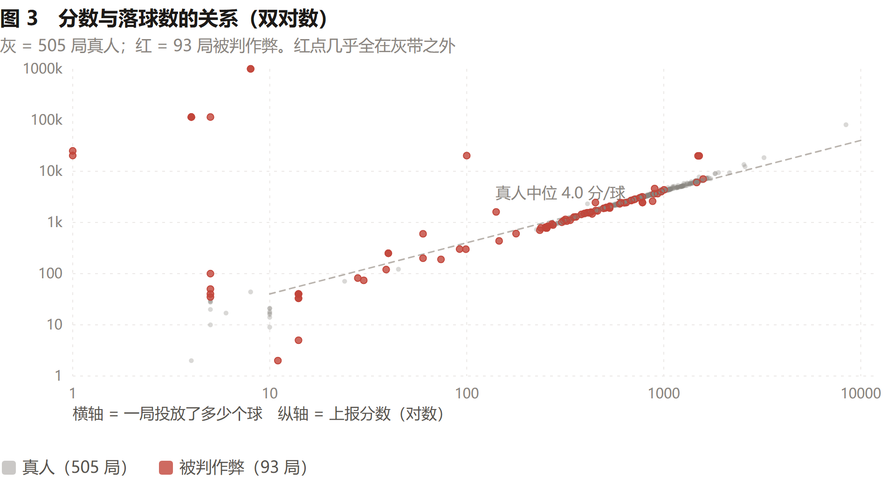
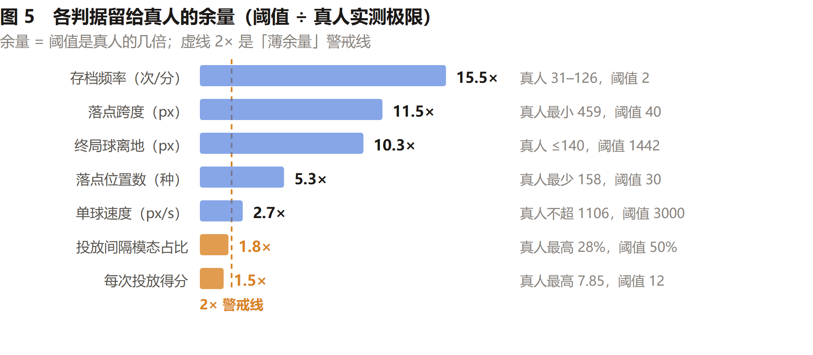

# 「合成大元火」排行榜攻防复盘（2026-10-17 → 10-31）

> 一个北大动漫社的网页合成游戏，15 天里被真实攻击了两轮、被红队打了三轮、自己也踩了四次坑。
> 这份文档记录**攻防双方各自做了什么**，以及每次判据改动背后的实测数据。
> 文中玩家昵称一律省略，攻击者用「脚本A/B」代称。

---

## 0. 一句话结论

**协议 2（客户端权威物理）让"服务端收到的成绩"本质上是不可验证的声明。**
加校验不能把它变成可验证的事实，只能把伪造成本抬高 + 把伪造留下的痕迹找出来。
这 15 天做的事，本质上是**把伪造成本从 91 秒抬到"必须真的打 11 个小时"**，
同时把每一次误判都记下来、修正判据的判定时机。

最终规模：

| | |
|---|---|
| 对局 | 598 局 / 517 个账号 / 15 天 |
| 被判可疑 | 93 局（15.6%） |
| 物理重放 | **32,858 次窗口重放**（每次都是服务端真跑一遍 Matter）|
| 真实存档 | 361,970 次 |
| 榜单 | 经典 7492 / 无尽 **81085**（11.5 小时，物理重放偏差 0）|

两条战线：**成绩可信度**（第 3–8 节）和**服务可用性**（第 3.5 节），下文分开讲。

---

## 1. 背景：为什么这个项目需要反作弊

游戏是合成大西瓜类：投球 → 同等级相撞合成更大等级。物理用 Matter.js。

协议演化出两版：

- **协议 1（服务端权威）**：客户端只上报"往哪投"，服务端跑物理。伪造不了，但每次投放要一个来回。
- **协议 2（客户端权威）**：客户端自己跑 Matter，只上报**自洽的 state**（球阵、分数、合成数、落点轨迹）。流畅，但服务端收到的是一个**无法验证的声明**。

我们用的是协议 2。于是所有反作弊判据都在回答同一个问题：
**"这个自洽的 state，是真打出来的，还是编出来的？"**

---

## 2. 攻防时间线



### 第一轮：伪造 state（10-18）

**攻击**：`POST /run/start` 拿 seed → 本地跑 LCG 预测球序 → 等 `(n−1)×400ms`（真实冷却）
→ 编一个自洽 state（`balls: []`、`merges = n−1`、`score = 10(n−1)`）→ 提交。
**成本 238 次投放 / 91 秒拿到经典榜第一。**

**防御**（全部是软标记，不拒绝请求）：

| 判据 | 依据 |
|---|---|
| 球数守恒 `balls = spawnCount − merges` | 游戏规则本身 |
| 单位守恒 `Σ场上球单位 = Σtrace单位 − 2047×循环` | 合成不改变单位总量 |
| 终局见证：`over` 时必须有球压过死亡线 | 客户端唯一结束路径是溢出 |
| 分数理论上界 | 从投放折算单位 × 系数 |
| 落点机械：种类数 / 跨度 / 节拍 | 真人落点连续、间隔散乱 |

**结果**：成本从 91 秒抬到 **180 秒**（要绕开"每次投放 ≤12 分"就得投更多球、等更久）。

### 第二轮：绕开统计判据（10-19 → 10-20）

**攻击方**：混沌投掷 + 分数顶到理论上界下沿 + 空场伪造 + 落点全随机 + 间隔随机化。

**防御演化**（这一轮是判据数量爆炸的阶段）：

| 时间 | 上线内容 | 触发原因 |
|---|---|---|
| 10-19 19:30 | **增量校验（窗口重放）** | 服务端自己推演相邻两次存档之间的物理 |
| 10-19 19:53 | **分数增长曲线** `score ≤ 1200 + 4×秒` | 193 秒报 5786 分不可能 |
| 10-19 22:48 | 自动投放判据改 **OR**（落点机械 或 节拍机械）| 漏掉"随机落点 + 精确节拍" |
| 10-19 22:50 | 自动投放**挪到提交时** | 半截 trace 判不完整 |
| 10-19 22:58 | 落点阈值**随投放数阶梯上升** | 开局落点天然少 |
| 10-19 23:54 | **规避物理推演 DODGE_RULE** | 红队把存档间隔拉到 9 秒躲开重放 |
| 10-20 00:23 | 冷却冲突计数 + 投放间隔 390→400 + **台账不变量** | 红队把间隔压到 403ms 让重放全部失败 |
| 10-20 00:29 | 悬浮球阵 + 秘技声称矛盾 | 把整块球阵凭空上抬 772px |
| 10-21 | 容器越界 + 压线计时 | 改宽落球区 / 改高死亡线 |

### 第三轮：稳定期（10-21 之后）

```
10-17  87 局 /  9 可疑
10-18 202 局 / 31 可疑
10-19  87 局 / 24 可疑
10-20  74 局 / 24 可疑
10-21  21 局 /  2 可疑
10-22  27 局 /  0 可疑
10-23  26 局 /  0 可疑
10-24  12 局 /  0 可疑
10-25   6 局 /  0 可疑
10-26  18 局 /  0 可疑
10-27  13 局 /  0 可疑
10-28   9 局 /  0 可疑
10-29   1 局 /  0 可疑
10-30   4 局 /  0 可疑
10-31  11 局 /  3 可疑
```

**10-22 到 10-30 连续九天零判定。** 最后一天（10-31）又冒出一个「打分器GPU」——
三局都是半自动的低效尝试：两局谎称终局但 trace 里没有任何球压过死亡线，
一局单位守恒差了 16 个单位（trace 1644，实际 1628）。三次全部被拦下，最高 1434 分。

攻击者（脚本A：21 点固定网格 + 2000ms 节拍）前后提交了 26 局，**每一局都被落点判据抓住**，
最后一次尝试在 10-20 08:05。之后没有成规模的攻击。

---

## 3. 判据总表（最终版）

### 3.1 硬校验（直接 400，数据不入库）

| 判据 | 说明 |
|---|---|
| 结构与类型 | version/mode/status/字段范围 |
| 单调性 | score / merges / spawnCount / elapsed 不能倒退 |
| **墙上时间** | `elapsed ≤ 墙上时间 + 1.5 秒`；`started_at` 只在 INSERT 时写，没有 UPDATE 路径 |
| 时钟自洽 | `now` / `engineTime` 与 `elapsed` 相差 ≤100ms |
| trace 结构 | 时间戳单调、不超出 elapsed、前 5 球必须是新手引导、等级在池内 |
| `over` 后不可变 | 终局状态不能再改 |

### 3.2 软标记（记入复核队列，成绩不上榜）

| 判据 | 判定时机 | 标定依据（真人实测） | 命中 |
|---|---|---|---|
| 落点/节拍机械 | 提交时（完整 trace）| 一整局最少 158 种落点；60–120 次投放时可以低到 4 种；节拍众数占比 ≤34% | 46 |
| 终局见证 | 每次存档 | 客户端唯一结束路径是溢出 | 17 |
| 分数理论上界 | 每次存档 | 单位折算 × 系数 × 1.15 | 14 |
| 守恒律（球数 + 单位）| 每次存档 | 游戏规则；`cleared > 0` 时放宽 | 20 |
| 台账不变量（分数 / 合成 / 循环）| **终局** | 真人上报值**精确等于**台账（等式，不是上界）| 12 |
| 投放间隔过密 | 每次存档 | 真人最快也有 400ms 冷却 | 7 |
| 存档节奏 / 间隔过长 | **终局** | 真人 31–126 次/分（网络差的低到 5.4）| 7 |
| **规避物理推演** | **终局** | 真客户端每 2 秒存一次，宽窗口(>3s)只来自网络失败 | 6 |
| 终局球间距异常（改球半径）| **终局** | 真人相邻球间距 ≈ 半径和 | 6 |
| 其他结构性 | 每次存档 | 时长非法 / 缺操作序列 / 球位置跳变 / 投放数超时长 | 4 |
| 物理推演不一致 4σ | 每次存档 | 单窗口偏差 σ≈0.9、零均值 | 3 |
| 最高等级与单位数不符 | 每次存档 | 等级 11 需要 1024 个单位 | 3 |
| 每次投放得分超上界 | 提交时 | 真人 p50 3.95、最高 7.85 | 1 |
| 分数增长曲线 | 每次存档 | 真人峰值 6.95 分/秒、中位 1.5 | 1 |
| 球阵悬空 | **终局** | 真人最低球离地 ≤140px | 1 |
| 秘技删除上界 | 每次存档 | 单次几何上限 3200 单位 | 0 |
| 容器越界 | 每次存档 | 616 个真实状态里球心越界 0 例 | 0 |
| 压线后迟迟不结束 | 终局 | 客户端规则"压线连续 2 秒必死"，实测最大 2.5 秒 | 0 |

> 「命中」= 命中该条的局数，一局可命中多条。93 局被判可疑，其中 40 局是多条同时命中。
> 数字由 `tools/export-security-stats.mjs` 从 `run.flag_reason` 直接统计，可复现。

---



## 3.5 网络层与可用性：另一条战线

前面所有判据解决的是"成绩能不能伪造"。但攻击者还有一条更便宜的路：
**不伪造任何成绩，只要把站打挂、或者把事件循环占满，排行榜就失去意义了。**

这一块和判据是**完全独立的**——反作弊判据再准，进程被一个畸形请求打挂也一样没用。

### 3.5.1 实测的 CPU 成本（决定防线分层）

| 事实 | 数值 |
|---|---|
| 一次最坏的 checkpoint（含物理重放）| ~20ms 服务端 CPU |
| 单线程 Node 每秒能处理 | **~32 次** |
| 也就是说 | **一个 IP 就能把整个事件循环占满、全站卡死** |

这条数字决定了防线必须分三层：边缘（nginx）→ 应用（Node 内限流）→ 进程（cluster + 资源上限）。

### 3.5.2 三层防线（当前线上配置）

**第一层：nginx 边缘**（`deploy/nginx-yuanhuo.conf` + `conf.d/yuanhuo-rate-limit.conf`）

```nginx
limit_req_zone  $binary_remote_addr zone=yh_api:10m    rate=10r/s;   # 一般 API
limit_req_zone  $binary_remote_addr zone=yh_start:10m  rate=2r/s;    # 开局（写库 + 插行，最贵）
limit_req_zone  $binary_remote_addr zone=yh_submit:10m rate=6r/m;    # 提交（正常人一局一次）
limit_conn_zone $binary_remote_addr zone=yh_conn:10m;

limit_conn yh_conn 10;              # 每 IP 最多 10 条并发连接 → 挡 slowloris
limit_conn_status 429;              # 限流回 429 而不是 nginx 默认的 503
limit_req_status  429;
client_body_timeout   15s;          # 三个超时一起压，挡慢速攻击
client_header_timeout 15s;
send_timeout          15s;
client_max_body_size  1m;           # 与后端 MAX_BODY 一致
```

**第二层：应用内限流**（`server/index.js`，按 IP + 按 clientId 双维度）

| 接口 | 每 IP | 每 clientId |
|---|---|---|
| 存档 `game-sync` | 1200/分（20/秒）| 240/分 |
| 会话 `game-session` | 120/分 | — |
| 提交 `submit` | 30/分 | — |
| 排行榜 `board` | 120/分 | — |
| 改签名 `nick` | 20/分 | — |
| 统计/后台 | 30/分 | — |

> 存档限额 1200/分是"真实需求的 50–100 倍"——真人每 1–2 秒存一次，即 30–60 次/分。
> 这个数字**只许降不许升**，它同时是"防刷"和"别误伤"的平衡点。

**第三层：进程与资源**（systemd + cluster）

```
WEB_CONCURRENCY=4      # cluster：4 个 worker，一个被刷爆不连累其它
CPUQuota=350%          # 全服务总配额（4 vCPU 机器）
MemoryMax=1200M        # 目不是省资源，是限爆炸半径
TasksMax=1024
NoNewPrivileges / ProtectSystem=strict / ReadWritePaths=server/data
SystemCallFilter=@system-service
```

机器规格：**4 vCPU / 3.7GB**。

**第四层：fail2ban**（主机层，已有 `nginx-limit-req` 和 `sshd` 两个 jail）。

### 3.5.3 三个真实的可用性事故

| 事故 | 现象 | 根因 | 修法 |
|---|---|---|---|
| **畸形 Host 头打挂进程** | 一个 `Host: [` 的请求能让整进程退出，systemd 拉起、再打、崩溃循环 | `new URL(req.url, 'http://' + req.headers.host)` 在 async 回调的第一行、try 之外抛 TypeError → unhandled rejection → 进程退出 | 解析放进 try，失败返回 400 |
| **深嵌套 JSON 按需 500** | 20000 层嵌套的 `state` 让 `JSON.stringify` 抛 `RangeError`（爆栈），发生在校验之前 | 幂等判断要算内容哈希，而哈希用 `JSON.stringify`（递归）| 包一层 `contentHash()`，捕获后按 `400 进度数据嵌套过深` 处理 |
| **trace 成了免费写盘通道** | 每次请求可以让服务端往磁盘写 1.5MB，且 `suspicious=0` | 直接 `JSON.stringify(trace)` 全量入库，而 `trace.x` 完全没被校验过 | 入库前截断：`TRACE_VERIFY_MAX=20000` 条 / `TRACE_STORE_MAX=200KB` |

第三个事故最能说明网络层的性质：**它不是"打挂"，是"用合法请求做慢速资源耗尽"**。
判据跑得再准，磁盘也会被写满。

### 3.5.4 反向的教训：限流也会误伤真人

`s /api/run/submit` 曾经单独设了 `client_max_body_size 64k`（想着"一局只交一次，包很小"），
但提交包带**完整 trace**（每次投放一条，约 32 字节），是随对局长度线性增长的：

| 分数 | trace 大小 |
|---|---|
| 9443 | 57.8 KB |
| 12319 | 79.5 KB |
| 18454 | 98.3 KB |
| 81085（现在榜首）| **约 300 KB** |

于是**分越高的局越交不上**——一局 11 小时的 81085 分会被 nginx 直接 413。
改法：`1m`（trace 上限 20000 条约 640KB，仍有 1.6 倍余量）。

**教训：限制请求体之前，先看包里最长的字段随什么增长。**

### 3.5.5 日志里真实发生过的网络攻击

上面都是"设计"，这一节是"事后"。把两周的 nginx access/error log 全量拉出来按 IP 聚合之后，
结论很清楚：**公网上的服务器没有"安静"这种状态**，而且确实有几次是冲着我们来的。

**先分清两类流量。** 绝大多数是互联网背景噪音——任何人开一台公网机器都会收到，
它和我们无关，也不值得为它改任何东西：

| 噪音类型 | 日志里的样子 |
|---|---|
| 挖矿矿池探测 | `{"method": "mining.subscribe", "params": ["cpuminer/2.5.1"]}`、`eth_submitLogin` |
| RDP 探测 | `\x03\x00\x00...Cookie: mstshash=Administr` |
| 协议探测 | 明文端口收到的 TLS ClientHello（`\x16\x03\x01`）、XMPP `stream:stream to='scan.invalid'`、`PRI * HTTP/2.0` |
| 目录扫描 | `/nmaplowercheck*`（Nmap）、`zgrab`、`lvisionheight.com/scan`、`Mozlila/5.0 ... Bulid/NRD90M`（连 UA 都拼错） |

**然后是真正针对我们的。** 按"打到了什么"排序：

| 攻击 | 规模 | 结果 |
|---|---|---|
| **云凭据扫描**：`/stubs/tencent.json`、`/sts-tc.config.yaml`、`/stubs/oss.json`、`/stubs/.env`，UA 轮流伪装成 `Googlebot/2.1` / `curl/7.68.0` | 单 IP 一天 12,467 次请求 | 全部 401 / 404，**零命中** |
| **密钥扫描**：`.env` × 数十种变体、`.git/config`、`.git-credentials`、`.svn/wc.db`、`yarn.lock`、`.yarnrc` | 两周累计 6,489 次 401 + 5,038 次 404 | **零命中** |
| **后台 API 爆破**：`/api/admin/leaderboard`、`/api/admin/stats`，含**空字节注入** `/api/admin%00/leaderboard` 与路径穿越 `/api/admin/../admin/stats`、`/api/admin%2fstats` | 47 次 | **0 次 200**：34 次 403（token 校验拦下）、2 次 400（nginx 直接拒非法 URI） |
| **检查点洪泛**：Python 脚本（`Python-urllib/3.13`）高频打 `/api/run/checkpoint` | 一个 IP 40 分钟内 2,586 次，单分钟峰值 **923 次（15/s）** | 797 次被 `yh_api 10r/s` 限成 429，660 次被硬校验 400，**事件循环没被打满** |
| **SSH 爆破** | 两周 5,985 次失败登录 | fail2ban `sshd` jail 累计封 **208 个 IP** |
| **一次性集中扫描** | 单个云主机 IP 在 **16 秒内**打 580 个请求（UA 含 `ReconX-L2S/1.0`）| 全 401/404 |

四次真正有威胁的，两次是"找文件"（凭据/密钥），一次是"找后台"，一次是"占 CPU"。
**它们分别被三样东西挡住：文件系统边界、admin token、边缘限流。** 一个都没漏。

**两点必须记下来的观察：**

1. **`/api/run/checkpoint` 是被打最多的接口**（两周 20 万+ 次），不是 `/submit`。
   攻击者的直觉是对的——提交有 `6r/m` 的死限额，而 checkpoint 是"合法实时接口"，
   天然可以高频调，且每次都要跑物理重放。**最贵的接口一定是被刷的那个。**
2. **扫描器会把 SPA 的 fallback 当成"命中"**。我们所有未知路径都回 `index.html`，
   于是 `/.env` 在扫描器眼里是 `200 text/html`。这不是泄漏（回的是首页），
   但意味着**光看状态码 200 判断"有没有被拿到东西"是错的**，
   审计时必须看响应体长度和 content-type。反过来说，它也让扫描器觉得"这站有东西"，会被反复扫。

**为什么这次能一眼看出"真有攻击"：** 因为平时就存着全量的边缘日志，且三个 vhost 的
认证边界是分开的（游戏站、其他站点各自独立）。如果没有这两条，上面这些 401/404
就会被当成"用户输错密码"混过去。

---



## 4. 三次成功绕过（红队打出来的）

### 4.1 绕过「增量校验」：把存档间隔拉到 9 秒

增量重放只认 `|Δelapsed| ≤ 3 秒` 的窗口（长窗口物理必然发散）。
本该挡住这条的「存档节奏」用的是 `revision`，而 **`/api/run/resume` 也会让它 +1** ——
于是在 60 次真实存档之间插 259 次 resume：节奏算出来 22 次/分（阈值 20）过关，
但每个 checkpoint 的真实间隔是 9000ms → 重放全部超限 → `sim_checks` 恒为 0。

**成本 862 秒 / 322 个请求，4597 分上到经典第 10，零标记。**

**修法**：不再看计数器，改看**窗口形状**。真客户端 `saveProgress` 由 2 秒定时器驱动
（`web/src/main.ts`），切后台是暂停、模态框期间既不存档也不推进 ——
所以真人的宽窗口只可能来自网络失败。

- `state_writes ≥ 8` 且 `wide_writes / state_writes ≥ 50%` → 标记
- 真实存档速率 < 20 次/分 → 标记（后来降到 2，见 §5.4）

### 4.2 绕过「窗口形状」：把投放间隔压到 403ms

`replayWindow` 里 `if (!sim.drop()) return null;` —— 冷却冲突被当作"无法推演"**静默跳过**。
trace 相邻间隔落在 `[390, 400)` 时：不触发 `fastDrops`（阈值 <390）、
每个窗口都因冷却冲突返回 null、节拍判据的 600ms 下限也够不到。

**成本 355 秒 / 139 个请求，2600 分上榜。**

**修法**：① 投放间隔阈值 390 → **400**（前端冷却就是 400，生产 217 局最短间隔 min=400、p1=400）；
② 冷却冲突**计数报账**：`尝试 ≥10 且冲突占比 ≥80%` 就标记。阈值取 0.8 而不是建议的 0.3，
因为真人顶着冷却连点实测冲突率也有 65%。

### 4.3 分数不是自由变量：台账不变量

红队给出了最强的判据。逐级球守恒：

```
drops_k + M_{k-1} = 2·M_k + final_k + D_k     （D_k ≥ 0 = 秘技删除）
⇒ M_k ≤ ⌊(drops_k + M_{k-1} − final_k) / 2⌋
⇒ maxScore = Σ(k+1)·M_k + 循环/共鸣加成，只依赖 (trace, 终局球阵)
```

**本地用真客户端打了 6 局验证：上报分数与合成数都精确等于台账上界（比值 1.00，一局不差）。**
所以它不是启发式，是**等式**——秘技删除只会让实际值更小，不影响上界。

效果：同一局伪造，旧的 units 上界 11,970（拦不住 4597）→ 台账 3,636（直接越界 961 分）。

⚠️ 一个自己踩的坑：**无尽模式的循环是自引用的**（回收把两个完全体变回一个 Lv1 球，
那个球又能继续合成），从 `M[11]=0` 起手的不动点解不出来，整条链系统性少算一次循环，
差值恒为 **565 分 + 11 次合成**。必须用客户端上报的 `loopCount` 作为起点再迭代。
谎报 loopCount 由单位守恒负责抓（谎报 9 次循环 = 凭空少 18423 单位）。

---

## 5. 我们自己造成的误判（四次同名事故）

这部分是这份文档最该被开源的部分：**判据本身没错，是判在了错误的时间点。**

### 5.1 台账判在了中途（10-20）

真人 `玩家D` 打了 9,362 分，被台账判越界。但用**终局**球阵重算完全在界内。
原因：台账的上界依赖"当前球阵"，而中途球阵是瞬时状态 —— 循环刚吃掉两个完全体、
回收球还没参与合成的那一刻，上界被临时压低。**分数是单调的，终局能过就说明中途那次是假警报。**

→ 改：只在 `status === 'over'` 判。

### 5.2 球阵悬空判在了中途（10-20）

真人 `玩家C` 被「球阵悬空 451px」判掉。终局球阵完全正常（最低球离地 45px、速度全 0），
451px 是中途"底下几排刚合成掉、上方的球还在下落"的瞬时状态。他那局有 1631 次存档，
撞上下落瞬时的概率很高。

→ 改：只在 `status === 'over'` 判。

### 5.3 存档节奏是累积判定（10-23）

真人 `五条悟` 被「存档节奏 11.1 次/分」判掉 —— 那条标记来自**开局 36 秒**的窗口
（当时他停在开局的发现动画里），而整局真实速率是 **35.9 次/分**。
累积判定会把一次瞬时低谷永久钉死。

→ 改：只在 `status === 'over'` 判，并用 `state_writes`（真实存档次数）而不是 `revision`。

### 5.4 规避推演 / 冷却占比同样是累积判定（10-23）

同一类问题。宽窗口占比、真实存档速率、冷却冲突占比都是**整局平均**性质的量。
→ 全部改成终局判。

### 5.5 其他几次

| 事故 | 原因 | 修法 |
|---|---|---|
| 自动投放误标 3 局 | 拿**半截 trace** 套按完整 trace 标定的阈值（真人开局前 60–120 次投放落点最少只有 4 种）| 挪到提交时判 |
| 球位置跳变误标 | `Math.max(1, elapsed差)` 把"游戏时间没推进"钳成 1ms，允许位移只剩 203px | 窗口 ≥300ms 才判；id 对上不到一半不判（`resume` 会重编号）|
| 长局提交失败（413） | nginx `/api/run/submit` 设了 `client_max_body_size 64k`，而提交包带完整 trace（2553 次投放 = 79KB）| 改 1m + 加兜底定时器抢救"打完没提交"的成绩 |
| 6 小时上限卡死真玩家 | 一个真玩家打了 6 小时无尽局（31898 分），每次存档都被 `elapsed ≤ 6h` 拒 | 上限 6h → 24h（真正的约束是"elapsed ≤ 墙上时间"）|
| 存档节奏阈值 20 太高 | 网络差的真人低到 5.4 次/分，已经落进伪造区间（0.1–7.7）| 20 → **2**（只抓批量上报）|

---

## 6. 红队两轮对抗

派了独立子 agent 做白盒红队（给了全部源码和全部判据参数），目标是"不真玩就上榜"。

**第一轮**：找到 resume 刷 revision 的绕过（§4.1），成功上榜。
**第二轮**（修复后重打）：

| 尝试 | 结果 |
|---|---|
| 老手法复测 | ✅ 被 DODGE_RULE 抓住 |
| 冷却冲突 + 存档从 140 秒才开始 | ✅ 被速率分支抓住 |
| **冷却冲突 + 从 0 秒起每 2.6 秒真存档** | ❌ **再次成功登上 top50**（§4.2）|
| 静止球阵"迎"着重放 | ✅ 每窗偏差 −10，第 2 个窗口就爆 |
| 一次性终局存档、不注水 | ✅ 存档节奏 |
| 分数顶到理论上界 | ✅ 分数曲线（862 秒只允许 4648，他报 4597）|
| 终局空场 / 没球压线 | ✅ 终局见证 |
| 定点投放 / 节拍宏 | ✅ 落点 + 节拍（19 倍 / 32 倍余量）|

红队还给出了台账不变量的推导（§4.3），那是这两周里价值最高的一条判据。

---

把 505 局真人和 93 局被判作弊的放在一起对比，结论和直觉相反：



作弊者不是「玩得更久」，而是「几乎不玩就直接上报」。


真人是贴着一条对角线的窄带（每球约 4 分），作弊点大面积溢出——有的远在上（伪造高分），有的远在下（0 分伪造局）。这张图是全部判据的几何来源。


## 7. 关键标定数据（复用时直接抄）

| 指标 | 真人实测 |
|---|---|
| 落点种类 | 一整局最少 **158**；60–120 次投放时最少 4，中位 53–69 |
| 落点跨度 | p1 907px，最小 459px（手机玩家可以很窄，玩家U 只 91px）|
| 投放间隔众数占比（10ms 分桶）| p50 2%、p90 9%、p99 28% |
| 单球最大位移 | 1106 px/秒；单球最大速度 1578 px/秒 |
| 单次投放得分 | p50 3.95、最大 7.85（上界设 12）|
| 每秒得分 | 峰值 6.95 分/秒（165 秒那局）、中位 1.5、长局 1.8–2.96 |
| 存档速率 | 正常 31–126 次/分；网络差的低到 **5.4** |
| 终局最低球离地 | p1 43px、中位 45px、≥8 球时最大 140px |
| 终局压线持续 | 2000ms（414/424 局）、最多 2500ms |
| 物理重放单窗口 σ | 1.0 秒 0.48 / 1.6 秒 0.87 / 2.5 秒 1.33（零均值）|
| 台账上界 | 真人上报值**精确等于**上界（6 局验证，比值 1.00）|

---



## 8. 从踩坑里总结的两条原则

### 8.1 判据要按"判定时机"分类

| 类型 | 例子 | 判定时机 |
|---|---|---|
| **逐帧可比** | 球位置跳变、投放间隔 | 每次存档（相邻两帧）|
| **瞬时精确** | 守恒律、秘技上界、容器越界 | 每次存档 |
| **累积随机游走** | 物理推演 4σ | 每次存档（样本越多越准）|
| **整局平均** | 存档节奏、宽窗口占比、冷却占比 | ⚠️ **只在终局** |
| **终局球阵性质** | 台账、球阵悬空、终局见证、堆叠自洽 | ⚠️ **只在终局** |

**"整局平均"和"终局性质"的判据如果挂在每次存档上，早年的一个瞬时低谷会把整局永久钉死。**
这条规则我们违反了四次，每次都是同一个症状：真人成绩被误毙，用终局状态重算却完全正常。

### 8.2 加判据前必须先量真人分布

每一条软判据上线的流程：

1. 先从生产库拿数据（`tools/` 里那些 `.mjs` 脚本就是干这个的）
2. 量真人的分布，看目标信号和真人 p99/max 之间隔几倍——**不到 2 倍就别加**
3. 决定判定时机（查上表）
4. 标定值写进注释：真人实测多少、余量几倍
5. 测试 → 本地 e2e → 备份上线 → 看真实流量有没有误标

---

## 9. 仍然开放的问题

1. **协议 2 的结构性问题没有根治。** 服务端仍只能"猜"客户端是否诚实。
   真正的解法是服务端权威物理（协议 1），但那要改交互模型、加客户端预测。
2. **秘技（删球）无法逐颗核验。** 只能给几何上界（3200 单位/次），
   而这个值故意压在真人实测上限 3333 之下——理论上真人也有极小概率撞上。
   根治需要客户端上报瞄准点（协议改动）。
3. **改高死亡线只能抓 10 秒以内的。** 服务端自己记"球压线持续多久"，
   但如果改动很小（多玩 <10 秒），仍然测不出来。
4. **分数曲线是经验包络，不是物理定律。** 真人会越练越快，将来一定有人顶到上沿，
   届时要重跑标定再放宽。
5. **客户端 bundle 泄漏游戏规则**（这是必须的），但不泄漏任何判据参数 ——
   `server/validate.js` 从来没被前端 import 过。

---

## 附：仓库里对应的文档

| 文件 | 内容 |
|---|---|
| `docs/GAMEPLAY-ANALYTICS.md` | 游玩数据分析：15 天 598 局的留存、时段与单局画像 |
| `docs/incremental-replay-20261019.md` | 增量校验的完整标定、判据推导、四次事故记录 |
| `docs/checkpoint-soft-flag-20261018.md` | 逐存档点软校验的设计与标定 |
| `docs/incident-submit-body-limit-20261019.md` | 提交包超限导致丢分的事故与兜底方案 |
| `data/public-dataset.json` | 598 局提交记录的匿名版（判据统计都从这里重算）|
| `server/validate.js` | 所有判据常量，每一条上面都写着标定依据和余量 |
| `tools/*.mjs` | 所有标定/审计/复现脚本 |
