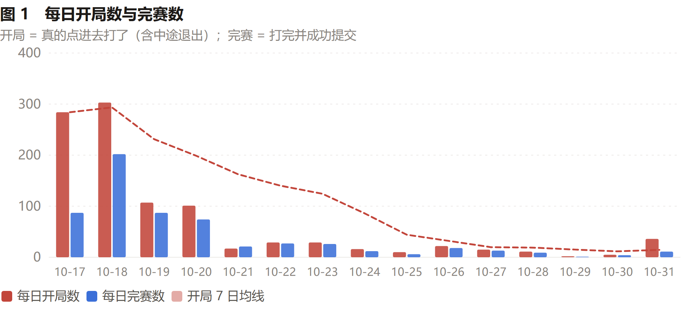
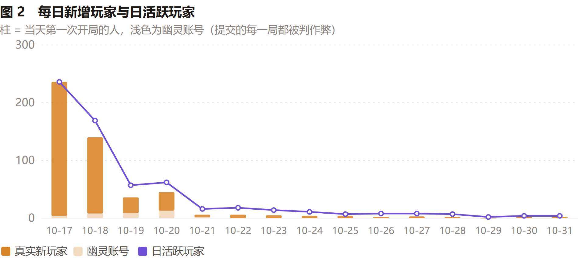
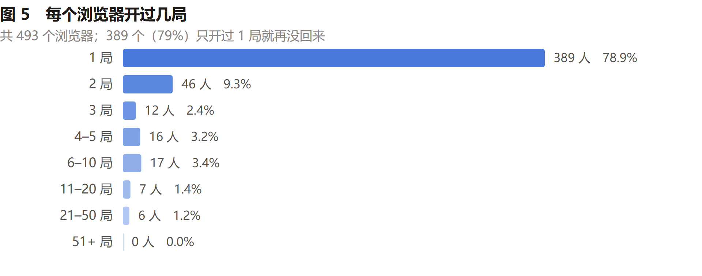
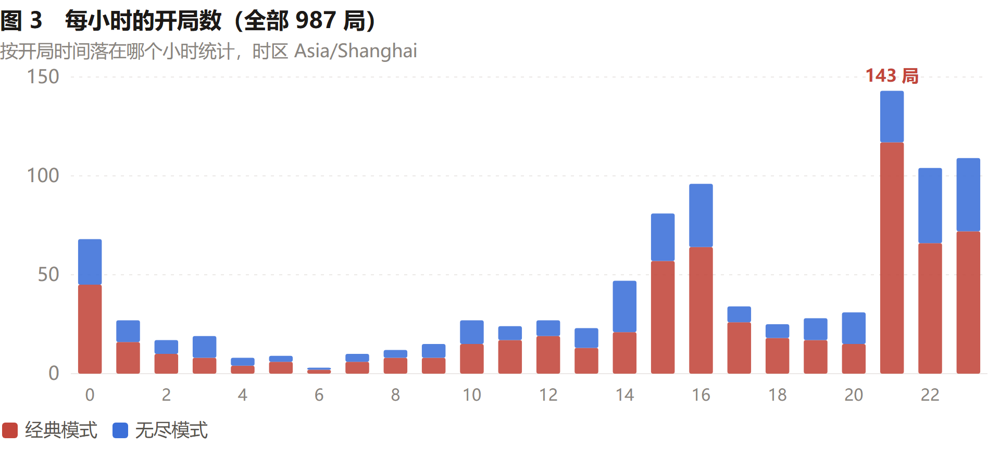
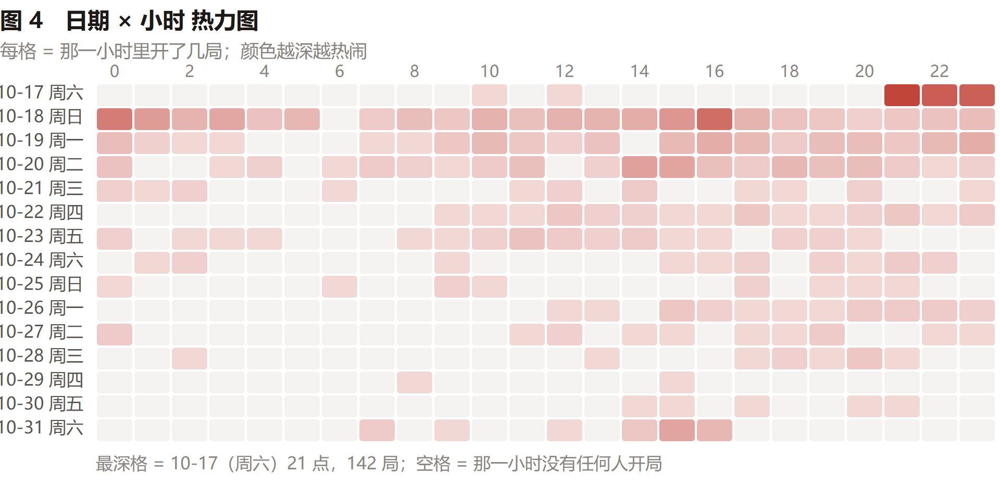
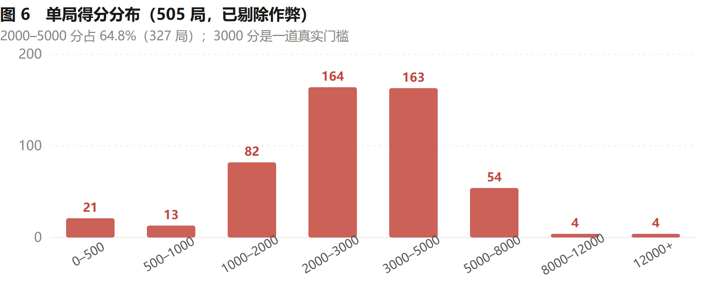
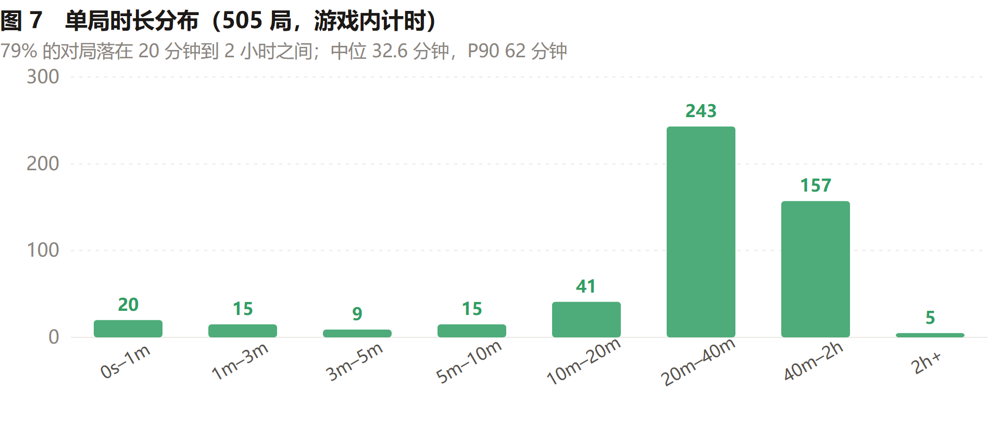
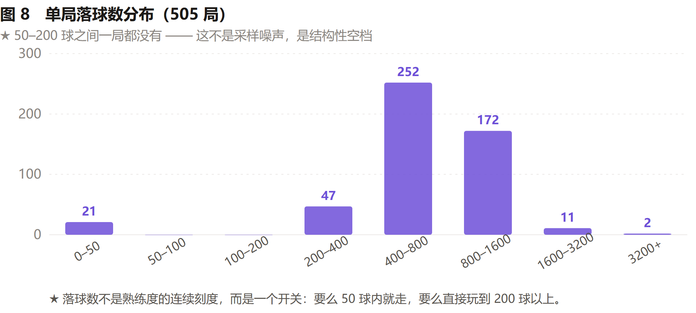

# 游玩数据分析：15 天，598 局

比赛 2026-10-17 上线、10-31 12:00 截止。这份文档看的是**人怎么玩**——
每天多少局、什么人来了又走、几点在玩、单局长什么样。

数据来源是同目录上一级的 [`../data/public-dataset.json`](../data/public-dataset.json)，
图全部由它直接画出。所有分数统计已剔除被判作弊的对局。

## 一页摘要

| 指标 | 数值 |
|---|---|
| 统计区间 | 2026-10-17 → 10-31（**15 天**） |
| 开局数 | **987 局** |
| 完赛并提交 | **598 局**（完成率 60.6%） |
| 独立浏览器 | **493 个**（其中 203 个起了昵称） |
| 真实新玩家 | **457 人**（另有 36 个作弊幽灵号） |
| 每人平均 | **2.0 局**（中位数 **1 局**） |
| 只玩一次就走 | **78.9%**（389 / 493） |
| 真实游戏时长 | **322.9 小时**（单局中位 32.6 分钟，P90 62.0 分钟） |
| 单局中位得分 | **2858 分**（P90 5189） |
| 作弊判定率 | **15.6%**（93 / 598 局） |
| 高峰时段 | **21 点**（143 局），21–23 点 + 0 点合计 **43.0%** |

**三句话结论：**

1. **这是一次「活动型」爆发，不是自然增长。** 首周（10-17~23）吃掉 88% 的局数，之后日均只剩十几局。
   峰值出现在上线第二天（10-18 周日 303 局）而不是第一天。
2. **问题不在「好不好玩」，在「要不要再来一局」。** 留下来的人单局中位 32.6 分钟、
   79% 的对局在 20 分钟到 2 小时之间。但 78.9% 的浏览器只开过一局。漏斗断在「第一局 → 第二局」。
3. **落球数是一条二元曲线，不是连续曲线。** 50–200 球区间**一局都没有**——要么 50 球以内就结束
   （约 1 分钟），要么直接冲到 200 球以上。中间没有「试两下就走」的地带。

---

## 一、数据口径

三个表各有语义，别混：

| 表 | 语义 |
|---|---|
| `live_game` | 每一次**开过的局**（每个存档点一行）。含中途退出 |
| `run` | 每一次**完赛并成功提交**的成绩。这是唯一进排行榜的数据 |
| `player` | 每个浏览器一个随机 UUID |

**已做的四处清洗：**

1. **上线前有 26 个测试账号**（10.01–10.16 建的 player 行但从没开过局），不计入新增。
2. **分数统计剔除作弊局**，只用 505 局有效成绩。10-18 混进过一局伪造的 `999999` 分，
   直接算平均会把当天均值拉到 14304。
3. **完成率只看全局的 60.6%**。按天算会超过 100%——10-21 开局 17 局、完赛 21 局，
   因为有 10-20 晚上开的局跨到 21 号才打完。
4. **时长用游戏内计时**，不是两个时间戳相减。后者会把挂机、断网、存档卡住的长局算进去。

---

## 二、每天玩了多少局

| 日期 | 星期 | 开局 | 完赛 | 真实新增 | 日活 | 均分 |
|---|---|---:|---:|---:|---:|---:|
| 10-17 | 六 | **284** | 87 | **232** | 236 | 2238 |
| 10-18 | 日 | **303** | 202 | 132 | 169 | 2804 |
| 10-19 | 一 | 107 | 87 | 27 | 57 | 3336 |
| 10-20 | 二 | 101 | 74 | 32 | 62 | 3869 |
| 10-21 | 三 | 17 | 21 | 4 | 16 | 4013 |
| 10-22 | 四 | 29 | 27 | 6 | 18 | 3980 |
| 10-23 | 五 | 29 | 26 | 5 | 14 | 3631 |
| 10-24 | 六 | 16 | 12 | 4 | 11 | 9783\* |
| 10-25 | 日 | 10 | 6 | 4 | 7 | 3350 |
| 10-26 | 一 | 22 | 18 | 2 | 8 | 3626 |
| 10-27 | 二 | 15 | 13 | 3 | 8 | 3350 |
| 10-28 | 三 | 11 | 9 | 2 | 7 | 3275 |
| 10-29 | 四 | 2 | 1 | 0 | 2 | 3932 |
| 10-30 | 五 | 5 | 4 | 2 | 4 | 3746 |
| 10-31 | 六 | 36 | 11 | 2 | 4 | 1715 |

\* 10-24 的均分被榜首那一局（81085 分）拉高，当天中位数只有 3028。**看趋势请用中位数。**

**观察**

- **峰值在第二天，不在上线当天。** 10-17 是 284 局，10-18 是 303 局。
  但没有出现第三天的二次传播——10-19 直接掉到 107 局（−65%）。
- **首周吃掉 88% 的流量。** 首周 870 局，后 8 天只有 117 局。
- **10-21 有个断崖，而且 10-20 新增的 45 个新用户无一人次日回访（D1 = 0%）。**
  同一天下午服务器正好有一波自动化脚本洪泛存档接口，值得对照
  [攻防复盘 §3.5](ATTACK-DEFENSE-REVIEW.md) 一起看。

---

## 三、新增与留存：79% 的人只玩一局

两天进人 **497 人**（占全部 457 真实新玩家的绝大多数），之后每天 0–6 人。
**获客完全依赖上线那一次推广。**

| 首次游玩日 | 人数 | 次日 D1 | 3 日 D3 | 7 日 D7 |
|---|---:|---:|---:|---:|
| 10-17 六 | 236 | **12.3%** | 2.1% | 1.3% |
| 10-18 日 | 140 | 5.7% | 1.4% | 0.7% |
| 10-19 一 | 36 | **19.4%** | 8.3% | 5.6% |
| 10-20 二 | 45 | **0%** | 0% | 0% |
| 10-21 之后 | 各 2–6 人 | 样本太小，无参考意义 | | |

D1 留存 12.3%（首日 cohort）不算差——桌面小游戏移动端通常在 10–20%。
但 **D7 只有 1.3%**，说明没有形成习惯。

**10-20 的 D1 = 0% 是最刺眼的一行。** 45 个人来玩，第二天一个都没回来。
而且不是幽灵号的锅：45 人里 13 个是幽灵号，剩下 32 个真实用户同样零回访。

| 玩了几局 | 人数 | 占比 |
|---|---:|---:|
| **1 局** | **389** | **78.9%** |
| 2 局 | 46 | 9.3% |
| 3 局 | 12 | 2.4% |
| 4–5 局 | 16 | 3.2% |
| 6–10 局 | 17 | 3.4% |
| 11–20 局 | 7 | 1.4% |
| 21–50 局 | 6 | 1.2% |

**这几乎是一个「一人一局」的产品。** 玩到 6 局以上的全部加起来只有 30 人。

---

## 四、什么时间在玩

| 时段 | 局数 | 占比 |
|---|---:|---:|
| **21–23 点 + 0 点** | **424** | **43.0%** |
| 14–16 点 | 224 | 22.7% |
| 17–20 点 | 118 | 12.0% |
| 1–9 点 | 120 | 12.2% |
| 10–13 点 | 101 | 10.2% |

**晚上 21 点单独一小时就占 14.5%（143 / 987）。**
真正的双峰是「下午 15–16 点」和「晚上 21 点后」，不是中午；
**17–20 点（晚饭时间）反而是低谷**，只有 118 局。

热力图能看出汇总里看不到的东西：**21 点那个尖峰里，上线当晚（10-17）贡献了一大块**。
去掉首日后晚间峰仍然存在，但高度打对折。

---

## 五、两种模式

| | 经典模式 | 无尽模式 |
|---|---:|---:|
| 开局数 | **650**（65.9%） | 337（34.1%） |
| 完赛数 | 399 | 199 |
| 有效局（剔除作弊） | 328 | 177 |
| 作弊判定 | 71（17.8%） | **22（11.1%）** |
| 单局中位分 | 2807 | **2961** |
| 单局 P90 分 | 5024 | 6522 |
| 历史最高 | 7492 | **81085** |
| 单局中位落球 | 704 | 745 |
| 单局中位时长 | 32.6 分钟 | 32.9 分钟 |

**两个模式的中位分几乎一样（2807 vs 2961）** —— 难度是对齐的，没有出现
「某个模式明显更好刷分」的失衡。

**但无尽的均值被长尾彻底带偏**：榜首 81085 是第二名的 **6.0 倍**，
所以评估无尽模式一定要看中位数，不能看均值。

有意思的是**经典模式的作弊率更高（17.8% vs 11.1%）**——大概率因为
经典模式分数上限低（理论最高就 7492），想上榜更容易走捷径。

---

## 六、单局画像

### 得分分布

中位 **2858**，P75 3755，P90 5189，P99 9362。
**2000–5000 这一段占了 64.8%（327 局）**，是非常集中的单峰。
**3000 分是一道真实门槛**——5000 以上只剩 62 局。

### 时长分布

中位 **32.6 分钟**，P90 **62.0 分钟**。
**79% 的对局落在 20 分钟到 2 小时之间（400 / 505）**——
手机小游戏里能让人坐下半小时的并不多。

注意 0–1 分钟那 20 局（4%），正好等于落球数小于 50 的那 20 局：
它们是「点进来立刻退出」的人，也是唯一真正的流失点。

### 落球数分布 ← 最重要的发现

**50–200 球之间一局都没有。** 这不是采样噪声，是真实的结构性空档。

**解读**：落球数不是「熟练度的连续刻度」，而是一个**开关**。
少于 50 球 = 不到 1 分钟就结束，这些人还没进入游戏状态就走了；
多于 200 球 = 认真在玩，一旦跨过去绝大多数会打到 400–1600 球（84%）。

中间没有缓冲带，说明**游戏的「入戏点」非常靠近开局**：
要么几秒钟内被吸引住并开始连点，要么几十秒内就关掉。

---

## 七、玩家水平在成熟

每日完赛局的中位分走势（剔除作弊）：

| 日期 | 完赛 | 中位分 |
|---|---:|---:|
| 10-17 | 78 | 2174 |
| 10-18 | 171 | 2489 |
| 10-19 | 63 | 2908 |
| 10-20 | 50 | 3565 |
| 10-21 | 19 | 3672 |
| 10-22 | 27 | 3716 |
| 之后 | — | 稳定在 2900–3500 |

中位分从 2174 涨到 3600 左右并稳定下来。这是典型的新手流退场、核心盘成型。
**在评估「游戏变简单或变难了」时，必须先扣掉这个人口结构变化**，否则会误判。

---

## 八、对做游戏的建议

**① 优化「前 50 球」（最高优先级）。** 落球数 50–200 之间有 0 局的结构性空档说明
入戏点在开局后几十秒内。78.9% 只玩一局，但留下来的玩 32.6 分钟——
所以优化资源都该压在这个窗口：前 3–5 次合成给更强的反馈；首局前 60 秒降低死亡压力；
引导只需覆盖前 5 球，别做长教程。

**② 存档失败必须让玩家看得见。** 10-20 来的人 D1 留存 0%，包括 32 个真实用户，
而同一天下午服务器正在被刷。现在存档失败是静默重试，玩家毫无感知——
很可能以为游戏卡了就再也不回来。这条查实了可能比任何玩法优化都值钱。

**③ 活动要压在 21:00–23:00。** 晚间三小时吃掉 43% 的流量。
18–20 点是全天最低谷，别在这时候推。

**④ 给「一人一局」加钩子。** 结果页给「再来一局」一个明确按钮并展示差多少破纪录；
每日首次成绩给一点额外展示；排行榜显示「你今天排第几」，制造回访理由。

**⑤ 无尽模式要不要压时长。** 榜首一局打了一万多分钟，天花板是耐力而不是技巧。
可选项：保持现状（承认它是挂机模式）；加时间收益递减；
或者加一个「最长单局」独立榜，让耐力赛有自己的赛道，不挤占主榜。

---

## 九、局限

1. **只有 15 天、598 局**，样本小且高度集中在社团内部。绝对值不能外推到大盘。
2. **「独立玩家」按浏览器算**，清缓存就是新用户。实测有一个 IP 下挂了 12 个账号，
   真实人数比 493 少。
3. **作弊判定率 15.6% 不能当「作弊玩家占比」**。93 个被判定的局里，
   很多是同一个人反复提交——按人去重只有 43 个玩家、其中 36 个是幽灵号。
4. **10-24 之后日均只有十几局**，逐日波动不代表趋势。单个玩家的一次 11 小时长局
   就能把当天曲线抬起来。
